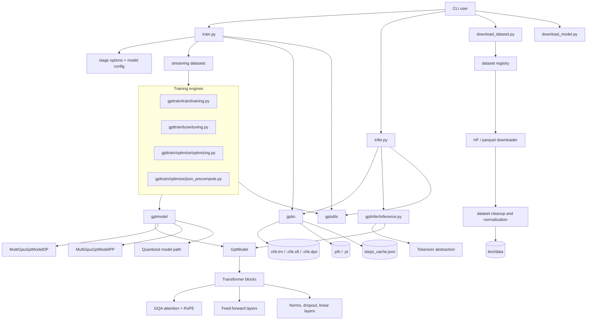

# Architecture Overview

## High-level read

This is a custom Python/PyTorch GPT research and training stack, optimized for local NVIDIA GPU experimentation on Windows. It supports:

- GPT pretraining
- Instruction fine-tuning / SFT
- Direct Preference Optimization / DPO
- Interactive inference
- Single-GPU, data-parallel, and pipeline-parallel execution
- FP16/BF16/FP8 and quantized inference paths
- Dataset downloading, cleaning, registry-based selection, and streaming
- Checkpointing, resume, telemetry, and loss plots

It is primarily a command-line application rather than a packaged reusable library or web service.

## Architectural sketch



## Major components

### 1. Command-line orchestration

- [`train.py`](train.py) is the central orchestrator.
  - `Training`: causal-language-model pretraining
  - `Fine-Tuning`: instruction/SFT training
  - `Optimizing`: DPO preference optimization
  - Handles argument parsing, model loading, device selection, precision, checkpoint resume, optimizer setup, and stage dispatch.
- [`infer.py`](infer.py) provides model loading, prompt handling, optional spell correction, interactive chat, and text generation.
- [`download_dataset.py`](download_dataset.py) exposes dataset acquisition and preparation.
- [`download_model.py`](download_model.py) delegates model retrieval to the `repos` subsystem.

### 2. Model implementation: `gptmodel/`

The model code is custom rather than using Hugging Face model classes.

Subcomponents include:

- [`gptmodel/GptModel.py`](gptmodel/GptModel.py)
  - Token embeddings
  - Absolute or rotary positional embeddings
  - Transformer block stack
  - Final normalization and language-model head
  - Chunked cross-entropy computation
  - Activation checkpointing
  - Optional FP8 conversion through `torchao`
- [`gptmodel/Transformer.py`](gptmodel/Transformer.py)
  - Residual transformer block composition
- [`gptmodel/Attention.py`](gptmodel/Attention.py)
  - Optimized grouped-query attention
  - KV caching
  - RoPE application
- [`gptmodel/FeedForward.py`](gptmodel/FeedForward.py)
  - MLP/feed-forward sublayers
- [`gptmodel/Modules.py`](gptmodel/Modules.py)
  - LayerNorm, RMSNorm, Gemma-style RMSNorm, GELU, and dropout
- [`gptmodel/MultiGpuGptModelDP.py`](gptmodel/MultiGpuGptModelDP.py)
  - Replicated data-parallel model execution
- [`gptmodel/MultiGpuGptModelPP.py`](gptmodel/MultiGpuGptModelPP.py)
  - Layer-split pipeline parallelism and microbatch scheduling
- [`gptmodel/GptModel_Quantized.py`](gptmodel/GptModel_Quantized.py)
  - Separate 4-bit quantized model implementation

### 3. Dataset system

The dataset layer has two responsibilities:

- Dataset acquisition and normalization:
  - [`dataset/download.py`](dataset/download.py)
  - [`dataset/cleanup.py`](dataset/cleanup.py)
  - [`dataset/registry.py`](dataset/registry.py)
- Runtime streaming and batching:
  - [`gptmodel/Dataset.py`](gptmodel/Dataset.py)

Supported dataset forms include:

- Plain text pretraining data
- Instruction/chat data
- Preference pairs for DPO
- Streaming tokenization
- Background prefetching
- Length-grouped and dynamically padded batches
- Dataset step-count caching

The registry is organized by training domain, including core, science, engineering, mathematics, and computer science.

### 4. Training engines: `gpttrain/`

- [`gpttrain/train/training.py`](gpttrain/train/training.py)
  - Pretraining loop
  - Evaluation and perplexity
  - Gradient accumulation
  - AdamW and custom Muon optimizer support
  - Learning-rate scheduling
  - Sample generation
- [`gpttrain/tune/tuning.py`](gpttrain/tune/tuning.py)
  - Instruction fine-tuning
  - Prompt masking
  - Instruction dataloaders
  - Interactive post-training chat
  - Loss plotting
- [`gpttrain/optimize/optimizing.py`](gpttrain/optimize/optimizing.py)
  - Online/reference-model DPO
  - Preference dataloaders
  - Log-probability and preference-loss computation
- [`gpttrain/optimize/json_precompute.py`](gpttrain/optimize/json_precompute.py)
  - Offline reference log-probability precomputation
  - Lower-VRAM DPO mode

The intended model lifecycle appears to be:

```text
Pretraining -> Instruction fine-tuning -> Preference optimization -> Inference
```

### 5. Persistence and path management: `gptio/`

- [`gptio/pathutil.py`](gptio/pathutil.py)
  - Centralizes model, dataset, checkpoint, options, and plot paths
  - Defines stage names and checkpoint naming conventions
- [`gptio/modelio.py`](gptio/modelio.py)
  - Model configuration and weight loading/saving
- [`gptio/checkpoint.py`](gptio/checkpoint.py)
  - Atomic checkpoint saves
  - Resume support
  - Optimizer and training-state restoration
- [`gptio/cache.py`](gptio/cache.py)
  - Dataset step/token caches
- [`gptio/gptioutil.py`](gptio/gptioutil.py)
  - Precision, AMP, option overrides, path resolution, and miscellaneous training helpers

The `bin/<model>/` convention is important. A model directory typically contains:

```text
model-params.json
options-{train,tune,optimize,infer}.json
tokenizer.json (optional; declared via the "tokenizer" key of model-params.json, see ARGUMENTS-TRAIN.md)
.pth model weights
.chk.trn / .chk.sft / .chk.dpo checkpoints
data/
logs
loss plots
steps_cache.json
```

### 6. Utilities: `gptutils/`

- Console output and progress bars
- GPU memory telemetry
- Logging
- Metrics and perplexity
- Process/file-lock helpers
- Training-stage summaries

### 7. Tests and operational scripts

The test suite is mostly Windows command-script-based end-to-end testing:

- [`tests/e2e/`](tests/e2e)
  - CPU/device tests
  - Multi-GPU DP/PP tests
  - Precision and low-VRAM tests
  - Resume/checkpoint tests
  - Dataset/path handling
  - Stage ordering
- [`tests/data/`](tests/data)
  - Model-specific inference and format-validation tests

The repository also contains many generated test model directories under `bin/`, which function as fixtures and output artifacts.

## Notable observations

- The architecture is fairly cohesive around the training pipeline, with `train.py` acting as a large application-level composition root.
- The project has strong hardware awareness: CUDA device selection, FP8, Triton compilation, activation checkpointing, pipeline parallelism, and VRAM management are all first-class concerns.
- There are two distinct multi-GPU strategies:
  - Data parallelism replicates the model and synchronizes gradients.
  - Pipeline parallelism partitions layers across devices.
- DPO has both an online reference-model path and a precomputed JSON path for reduced VRAM usage.
- The core directories do not appear to contain `__init__.py` files, so they rely on Python namespace-package behavior and explicit `sys.path` manipulation. This works locally but makes conventional packaging, installation, and tooling less straightforward.
- There is no obvious `README.md`, `pyproject.toml`, `setup.py`, or standard package metadata. [`requirements.txt`](requirements.txt) documents a very specific Windows/NVIDIA environment.
- The current worktree was dirty during analysis: there were tracked changes in `train.py`, several test model parameter files, and E2E scripts, plus newly added E2E scripts. No changes were made to those files during the analysis.

Overall, this is a capable, hardware-optimized personal/research GPT training framework with a practical end-to-end workflow, but with fairly tight coupling to its local Windows/GPU environment and a relatively monolithic orchestration layer.
