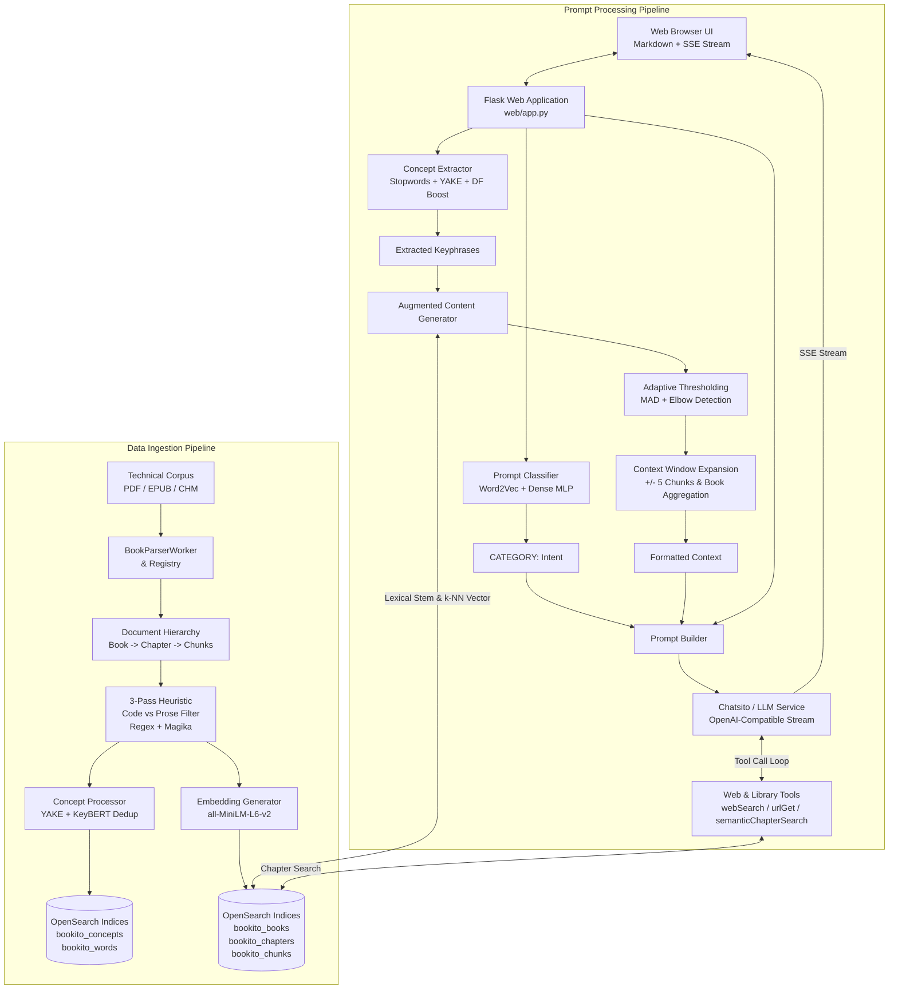
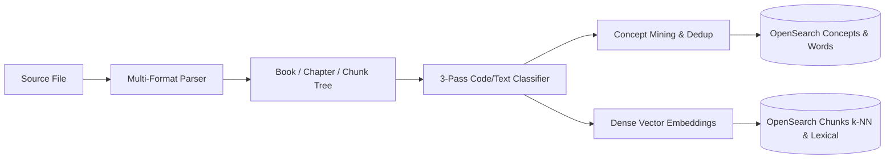
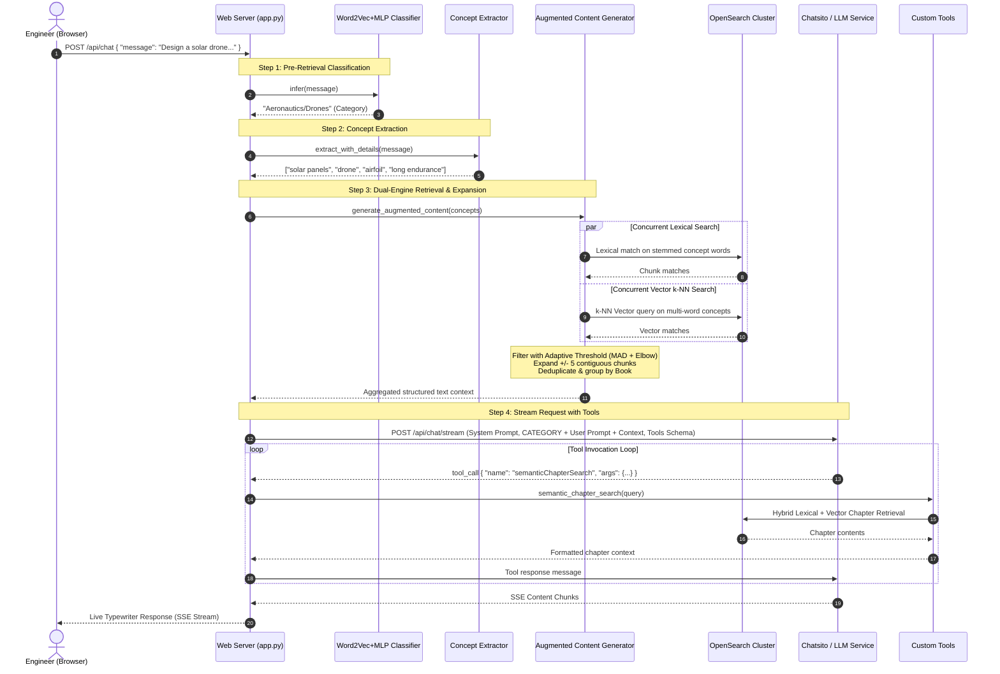
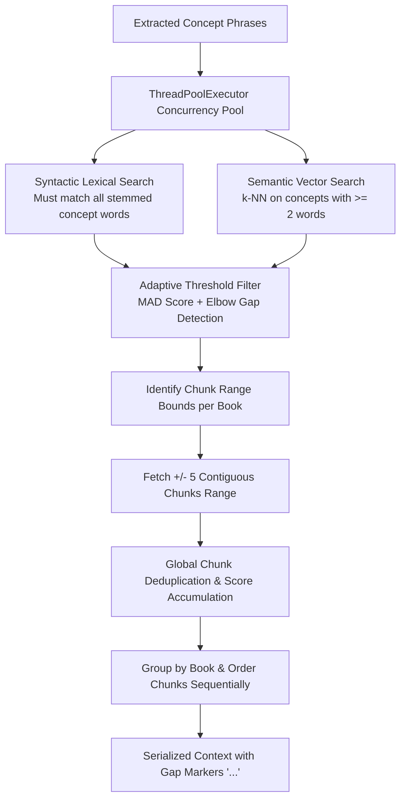

# Bookito Architecture Specification

## 1. Summary

### 1.1 Overview & System Purpose
**Bookito** is an AI-powered technical library intelligence and design document generation platform. Its primary objective is to assist software and hardware engineers in formulating rigorous technical design specifications with a deep, uncompromising focus on architectural tradeoff analysis (evaluating the pros and cons of every choice).

Unlike conventional Retrieval-Augmented Generation (RAG) systems that perform naive vector similarity over arbitrary text chunks, Bookito employs a multi-tiered architecture combining:
1. **Document-aware Hierarchical Ingestion**: Structure-preserving parsing of engineering literature (PDF, EPUB, CHM) with multi-pass prose versus code filtering.
2. **Domain Concept & Keyphrase Mining**: Statistical and semantic keyphrase extraction across chapters using YAKE, KeyBERT, and corpus-level document frequency scoring.
3. **Intent & Category Classification**: Pre-retrieval neural prompt classification (Word2Vec + MLP) that categorizes user requests across 54 engineering domains before query expansion.
4. **Hybrid Dual-Engine Retrieval & Adaptive Thresholding**: Parallel lexical (stem-matched) and semantic (k-NN vector) search in OpenSearch, filtered through Median Absolute Deviation (MAD) and Knee/Elbow drop-off algorithms.
5. **Context Window Expansion & Aggregation**: Dynamic expansion of matching chunks ($\pm 5$ contiguous blocks) with global deduplication and book-level aggregation.
6. **Tool-Augmented LLM Orchestration**: Continuous multi-turn tool calling (`webSearch`, `urlGet`, `semanticChapterSearch`) with live Server-Sent Events (SSE) streaming.



---

## 2. Data Ingestion Pipeline

The data ingestion pipeline transforms unstructured technical books and engineering documentation into clean, structured, and searchable representations indexed within OpenSearch.



### 2.1 Multi-Format Document Parsers (`parsers/`)
The parser layer extracts structured document hierarchies from diverse file formats while normalizing whitespace, handling line wrapping, and extracting chapter boundaries.

- **`BookParserRegistry`**: Central registry mapping file extensions (`.pdf`, `.epub`, `.chm`) to parser implementations. Supports parser instantiation with customizable line-unwrapping policies.
- **`BookParserWorker`**: High-level driver that inspects file extensions and delegates to the appropriate registered parser.
- **`PdfBookParser`**: Utilizes `pypdf` / `pdfplumber` to process page streams, extract embedded outlines/bookmarks for chapter detection, and reconstruct continuous paragraphs from fixed-width column layouts.
- **`EpubBookParser`**: Parses EPUB archives, traverses the package manifest and spine order, sanitizes XHTML markup using `BeautifulSoup`, and extracts title headings.
- **`ChmBookParser`**: Extracts Microsoft Compiled HTML help files, reads internal Table of Contents (`.hhc`) trees, and parses HTML topic pages.

### 2.2 Hierarchical Data Model & Tokenization (`book.py`)
Document structure is preserved in a three-tier object hierarchy:
- **`Book`**: Top-level entity representing a complete work. Contains unique numeric ID, title, file link, and an ordered list of `Chapter` objects.
- **`Chapter`**: Represents a distinct division or section. Contains chapter ID, chapter number, title, full text aggregation methods, and an ordered list of `Chunk` objects.
- **`Chunk`**: The atomic unit of text representation and retrieval. Contains chunk ID, index sequence number within the book, raw text content, classification type (`TEXT`, `CODE`, or `AMBIGUOUS`), and a GPT-2 `tiktoken` encoder instance for token counting.

### 2.3 Multi-Pass Content Classification & Heuristic Filtering (`processors/concept_processor.py`)
Technical engineering books mix source code listings, terminal sessions, and mathematical formulas with expository prose. Mining keyphrases from code blocks degrades retrieval quality. To solve this, a 3-pass classification algorithm isolates prose from code:

1. **Pass 1 - Lexical & Pattern Heuristics**:
   - Classifies lines using indentation analysis, programming language keywords (Visual Basic, C#, C++, SQL, Python), symbol-to-word ratios, capitalized sentence structures, and English prose stopword density.
   - Lines with high stopword density and terminal punctuation are classified as `TEXT`.
   - Lines matching regex patterns (e.g., variable declarations, SQL statements, block delimiters) are classified as `CODE`.
   - Unresolved lines are marked as `AMBIGUOUS`.
2. **Pass 2 - Neighborhood Context Smoothing**:
   - Evaluates lines in a 5-line sliding window ($i-2$ to $i+2$).
   - Bridges isolated transitions: if preceding and succeeding blocks are both `TEXT` (or both `CODE`), the middle ambiguous block is smoothed to match its surrounding context.
   - Identifies code block boundaries to prevent trailing syntax from contaminating prose.
3. **Pass 3 - Google Magika Neural Verification**:
   - Ambiguous chunks remaining after Pass 2 are evaluated by Google's `Magika` deep learning content type detector.
   - Chunks classified into `code` or `markup` content groups (excluding plain text or markdown) are designated as `CODE`.
   - Only confirmed `TEXT` chunks are fed into concept extraction.

### 2.4 Concept & Keyphrase Mining (`processors/concept_extractor.py`, `processors/concept_processor.py`)
Rather than relying solely on full-text search, Bookito builds an explicit domain vocabulary per book:
- **Candidate Extraction (YAKE)**: Chapters are processed concurrently across CPU cores. YAKE extracts $n$-gram keyphrase candidates ($n=1, 2, 3$) based on term frequency, casing, position, and sentence context.
- **Frequency Filtering**: Keyphrases must meet minimum single-word and multi-word occurrence thresholds within a chapter and across the entire book.
- **Scoring & Weighting**: Candidate scores are weighted by within-book chapter coverage ($Score_{final} = Score_{yake} \times Frequency_{chapters}$).
- **Semantic Deduplication (KeyBERT)**: Mined candidates are embedded using SentenceTransformers. A cosine similarity matrix is computed; semantically redundant phrases exceeding the similarity threshold (default $0.75$) are deduplicated, keeping the highest-scoring canonical phrase.

### 2.5 Dense Vector Embeddings (`embeddings/embedding_generator.py`)
- **Model**: `sentence-transformers/all-MiniLM-L6-v2`.
- **Dimensions**: 384-dimensional dense floating-point vector space.
- **Inference**: Batched vectorization (`batch_size=128`) run locally on GPU (CUDA) or CPU.
- **Scope**: Applied to each text chunk during ingestion and to query concept phrases during search.

### 2.6 OpenSearch Storage & Vector Indexing (`database/`)
OpenSearch acts as the unified storage engine for document hierarchy, vector search, and vocabulary statistics:

| Index Name | Purpose | Key Fields & Configuration |
| :--- | :--- | :--- |
| `bookito_books` | Book metadata catalogue | `book_id` (int), `book_name` (keyword), `file_link` (keyword) |
| `bookito_chapters` | Chapter text & ordering | `chapter_id` (int), `book_id` (int), `chapter_title` (text), `chapter_number` (int), `chapter_text` (text) |
| `bookito_chunks` | Atomic chunk vectors & text | `chunk_id` (int), `chapter_id` (int), `chunk_text` (text), `chunk_vector` (`knn_vector`, dim=384, HNSW Faiss L2, $M=16$, $ef_{construction}=128$, $ef_{search}=512$), `metadata` (`book_id`, `chapter_number`, `chunk_index`) |
| `bookito_concepts` | Mined domain keyphrases | `concept_id` (int), `book_id` (int), `phrase` (keyword), `score` (float), `chapters_count` (int), `total_occurrences` (int) |
| `bookito_words` | Corpus word document frequencies | `word` (keyword), `book_count` (int), `total_books` (int), `score` (float) |

---

## 3. Prompt Processing & Interactive RAG Pipeline

When a user submits a technical request, Bookito processes the query through a deterministic multi-stage augmentation pipeline before generating a streaming response.



### 3.1 Web User Interface (`web/templates/index.html`, `web/static/`)
- **Frontend Architecture**: Clean, responsive, dark-mode single-page interface using vanilla CSS and JavaScript.
- **Markdown & Code Highlighting**: Renders incoming LLM streaming responses in real time using `marked.js`.
- **Streaming Client**: Reads Server-Sent Events (SSE) via the Fetch API and `ReadableStreamDefaultReader`. Automatically detects tool execution phases and renders interactive visual state indicators (`*Using tools...*`).

### 3.2 Flask Backend API (`web/app.py`)
- **Initialization**: Singleton instances of `ClassifierWord2VecMLP`, `ConceptExtractor`, and `AugmentedContentGenerator` are initialized at application startup to eliminate cold-start latency on subsequent requests.
- **Routing**:
  - `GET /`: Serves the primary web interface.
  - `POST /api/chat`: Accepts `{ "message": "<user prompt>" }` payload and returns a streamed response (`Response(stream_with_context(generate()), mimetype='text/plain')`).

### 3.3 Intent & Category Classification (`web/model.py`, `web/classifier.py`)
Before search queries are dispatched to OpenSearch, the prompt is classified to establish top-level engineering intent:
- **Representation**: The prompt text is tokenized and transformed into a 300-dimensional dense vector by averaging the pretrained Google News 300 Word2Vec embeddings of constituent words:
$$\vec{v}_{prompt} = \frac{1}{|W|} \sum_{w \in W} \vec{v}_{w2v}(w)$$
- **Classifier Architecture (`DenseMLP`)**:
  - Input Layer: 300 dimensions.
  - Hidden Layer: 256 dimensions with ReLU activation and Dropout ($p=0.2$).
  - Output Layer: 54 dimensions (Softmax cross-entropy over canonical engineering categories).
- **Output Injection**: The predicted category is explicitly prepended to the user message in the prompt sent to the LLM:
```text
CATEGORY: [Predicted Engineering Category]

Prompt: [User Message]

Context:
[Augmented Technical Corpus Chunks]
```

### 3.4 Concept Extraction from User Prompts (`processors/concept_extractor.py`)
To prevent conversational noise (e.g., *"Can you please write me a design document for..."*) from polluting the search queries, the concept extractor applies:
1. **Conversational Stopword Stripping**: Removes conversational preambles and meta-instructions.
2. **YAKE Dynamic Extraction**: Extracts candidate keywords and phrases from the cleaned prompt.
3. **Multi-Factor Scoring**:
   - **Document Frequency Penalty**: Words common across many books (via `word_df_cache.json`) receive lower weight.
   - **Multi-Instance Boost**: Phrases appearing multiple times are boosted.
   - **Semantic Boost**: Candidates receive a boost if their embeddings align closely with the indexed `bookito_concepts` corpus.

### 3.5 Augmented Context Generation & Dual-Engine Retrieval (`processors/augmented_content_generator.py`)
Context assembly uses an aggressive multi-stage filtering and expansion strategy:



1. **Concurrent Dual Search**:
   - **Syntactic Search**: Queries OpenSearch text fields. Enforces that all words in the concept phrase must match via Snowball stem subset matching.
   - **Semantic Search**: Dispatches 384-d vector k-NN queries against `chunk_vector` for all multi-word concepts.
2. **Adaptive Score Thresholding**:
   Raw match scores are filtered through the higher of two mathematical boundaries:
   - **Median Absolute Deviation (MAD)**:
     $$\text{Threshold}_{MAD} = \text{Median}(S) + 3.5 \times \text{MAD}(S)$$
   - **Elbow / Knee Detection**: Computes differences between descending sorted scores and detects the first drop-off exceeding $\mu_{gap} + 1.0 \times \sigma_{gap}$.
3. **Context Window Expansion ($\pm 5$ Chunks)**:
   For every surviving chunk hit, a range query retrieves 5 contiguous chunks before and 5 contiguous chunks after ($[\max(0, index - 5), index + 5]$) to preserve surrounding code context, mathematical derivations, and paragraph transitions.
4. **Global Deduplication & Book Aggregation**:
   Overlapping expanded ranges are merged. Chunk scores are accumulated, and chunks are sorted in ascending sequence per book. Gaps between non-contiguous chunk segments are delimited with `...`, and books are separated with `--------------------------------`.

### 3.6 Tool Provisioning Layer (`web/tools.py`)
To enable autonomous information retrieval during generation, the LLM is equipped with function-calling capabilities:
- **`webSearch(query)`**: Performs live web searches via DuckDuckGo Lite and parses result snippets.
- **`urlGet(url)`**: Downloads and extracts clean text content from external web pages using `BeautifulSoup`, stripping scripts and styling up to an 8,000 character limit.
- **`semanticChapterSearch(query)`**: Executes a hybrid search across the local technical library. Finds matching chunk seeds via vector k-NN + lexical match, identifies the parent chapter ID, fetches all contiguous chunks for that chapter sorted by index, and returns the full chapter text up to 20,000 characters.

### 3.7 LLM Orchestration & Streaming (`web/app.py`)
- **Chatsito Protocol**: Communicates with the local Chatsito LLM server over HTTP POST with streaming response bodies.
- **Tool Calling Execution Loop**:
  1. App dispatches messages payload with tools schema.
  2. If the LLM generates a `tool_call` token:
     - Yields `*Using tools...*` to the browser stream.
     - Appends the assistant's tool-call request to the conversation history.
     - Executes the Python tool function locally.
     - Appends the tool result message (`role: "tool"`).
     - Recursively sends the augmented message history back to Chatsito.
  3. Content tokens are streamed directly to the browser as plain text over SSE until completion.
