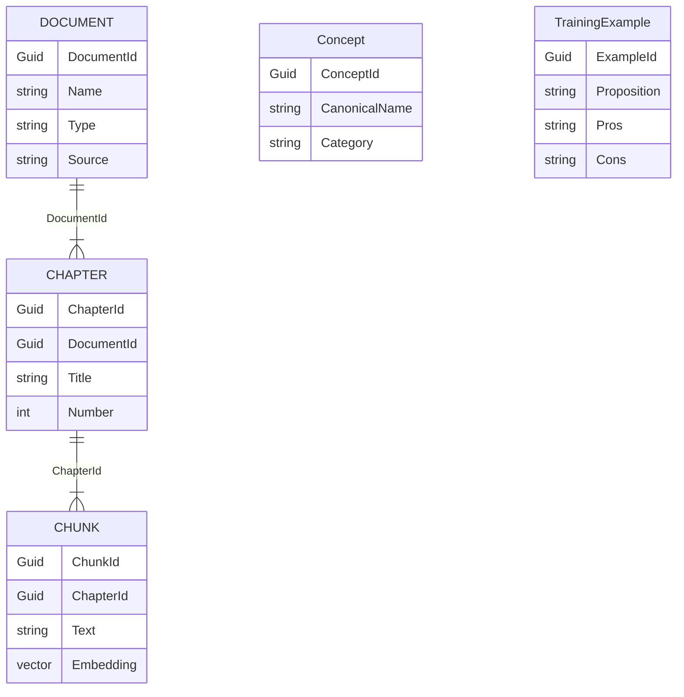
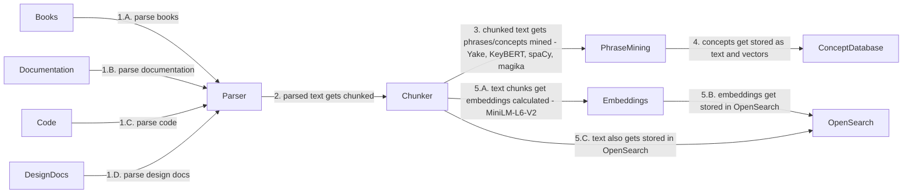
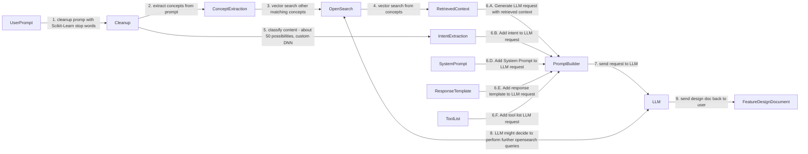
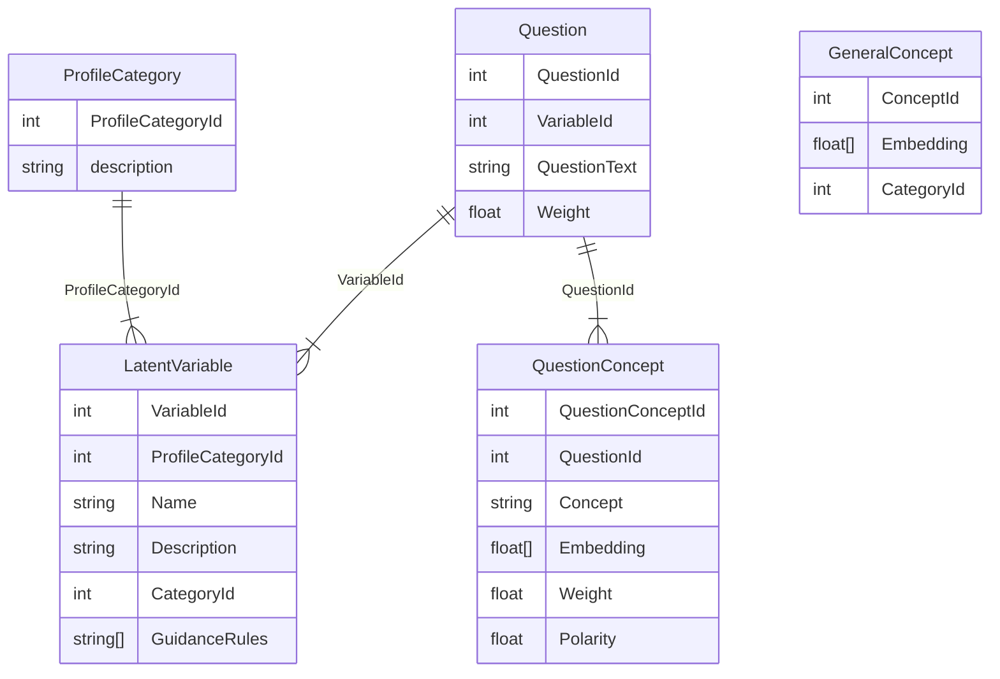

# Bookito - AI-Assisted Technical Design Generation Platform

## Overview

Bookito is an AI-powered technical library intelligence system whose primary purpose is to assist the user in generating engineering design documents that evaluate the pros and cons of the decisions.

Unlike a traditional Retrieval-Augmented Generation (RAG) system,
Bookito combines:

-   A large technical knowledge base
-   Hybrid text/vector retrieval
-   Concept extraction
-   Intent classification
-   LoRA fine-tuning specialized for engineering tradeoff analysis

Although this document focuses on **Drone Wide Web (Internet over
Drones)**, the overall architecture is domain independent.

------------------------------------------------------------------------

# Functional Requirements

## User Requirements

-   User provides a high-level engineering requirement.
-   Generate an initial Feature Design Document.
-   Support iterative refinement through follow-up prompts.
-   Retrieve relevant technical references from the engineering corpus.
-   Compare multiple architectural alternatives.
-   Explain tradeoffs.
-   Cite relevant source material whenever possible.

## Non-Functional Requirements

-   Low-latency prompt execution
-   Hybrid text + semantic retrieval
-   Extensible domain corpus
-   Local execution
-   Pluggable LLM backend
-   Swappable embedding models
-   Swappable LoRA models

------------------------------------------------------------------------

# Conceptual Data Model



------------------------------------------------------------------------

# Conceptual Services / APIs

-   Corpus Ingestion Service
-   Concept Extraction Service
-   Embedding Service
-   OpenSearch Service
-   LoRA Dataset Generation Service (script)
-   LoRA Training Service
-   Prompt Processing Service
-   LLM Service

------------------------------------------------------------------------

# High-Level Flow 1 - LoRA Training Dataset Generation

The LLM has to be LoRA fine tuned for the purpose of generating design that properly highlights pros and cons for any potential decision. This is a behavior not very emphasized by LLMs (at the degree needed for this project). In order to train this behavior, a specialized training Data corpus needs to be generated. This data corpus consists of a large set of foundational "propostions" (technology, technique, design pattern, etc) and options (A, B, C, etc) with their corresponding pros and cons. We started the data corpus with 10 manually made examples. Then we generated 40 more with the help of an LLM, based on the original 10 and a tiny fraction of the source material (books, documents, etc). After that, we manually fixed and improved those 50, and repeated the process to generate another 200 with a bit more source materials. The new 200 examples represented a marked improvement in quality over the previous, but they were tweaked and improved manually. FIinally, with a clean set of 250 examples we repeated the process with the full source material to generate 100,000 examples. These were tested and improved with some basic heuristic but for the most part they were used mostly as-is. Were they perfect? No, but they were good enough for the training. At that point, we used this data to fine tune the model.


------------------------------------------------------------------------

# High-Level Flow 2 - Corpus Preparation

The data source was composed of about 2000 books on relevant topics (Maxwell equations, rf signals, wifi, http protocol, etc), our existing project documentation, code base, design documents, pcb designs, etc. 
The 2 types of data we needed to generate are:
- A set of concepts - we used Yake & KeyBERT to collect all "common concepts" that are not semantically common leveraging both NLP and statistical analysis. Examples of these concepts include "transport tunnel", "wifi dB strength", or "pcb design".
- The corpous as chunked data in opensearch (text+vector database) collected by sentence, paragraph, section and chapter.



------------------------------------------------------------------------

# High-Level Flow 3 - Prompt Execution

Given a prompt, we would use Scikit-Learn to remove stop words. With the remnants, we used Yake seeded with the collected concepts to extract concepts from the prompt. We then used the extracted concepts to perform a vector search and retrieve all relevant sections or chapters to pass as part of the RAG context. We also used a small classification model to classify the intent from the prompt from a set of about 50 possible intents ("design a pcb", "software feature", "bug research", etc). We finally passed the retrieved data and the intent along with system prompt and the original user prompt to the LLM. Additionally we also provided a couple of tools to allow the LLM to search the vector database in case it needs additional information for other concepts or text it might want to retrieve more information on.



------------------------------------------------------------------------

# Prompt Processing

1.  Remove conversational framing.
2.  Match extracted concepts against the terminology database.
3.  Retrieve relevant context from OpenSearch.
4.  Extract semantic intent.
5.  Build the final prompt.
6.  Execute the LoRA-enhanced LLM.
7.  Allow iterative retrieval through search tools.
8.  Generate and refine the Feature Design Document.

------------------------------------------------------------------------

# Future Work

-   Knowledge graph generation
-   Multi-stage retrieval
-   Cross-document synthesis
-   Automatic benchmarking
-   Multiple domain-specific LoRAs


------


# Psychologically Augmented Prompt Engine

## Purpose

The goal of this project is to improve LLM responses (specially failures/hallucinations) by automatically inferring psychological traits, conversational preferences, and communication styles from the user's prompts and conversation history through behavioral analysis (akin to the ones used by the FBI for criminal behavior profiling).

This system uses conventional NLP, semantic search, embeddings, and deterministic scoring to generate explainable latent variables. These variables are then converted into prompt guidance that augments the downstream LLM prompt.

---

## High Level Design

- 2 categories: "what is the user like", "how does the user communicate"
- ~100 psychological questions (50/50)
- ~40 latent variables
- Question related concept lists
- Large Concept Collection
- OpenSearch vector search
- Local embedding model
- spaCy + YAKE + KeyBERT
- Rule-based scoring
- Weighted latent-variable aggregation
- Deterministic prompt guidance

Future versions may replace individual scoring rules with trained classifiers while preserving the same overall architecture.

### Data Model for Valuation Engine



### Latent Variable Engine

Each latent variable is computed from several related questions. The final latent-variable score is computed using a weighted aggregation of all associated question scores.

Example: Evidence Orientation Questions
• User Requests citations?
• User Seeks independent verification?
• User Distinguishes facts from opinions?
• User Prefers experiments?
• User Challenges unsupported claims?

Each psychological question has a curated list of related concepts.

Example Question:
> User Seeks independent verification?

> Associated concepts:
- verify
- double-check
- evidence
- citation
- independent confirmation

Each extracted concept from a prompt is compared against the question's concepts using vector cosine matrix using KeyBERT to generate a similarity score. The extracted concepts from the prompt are also compared against a second, much larger concept table and generate the score against these concepts as well. These scores are later used to assign a value to the latent variable (using a formula that takes into consideration multiple questions that relate to the same latent variable)


### High-Level Prompt Flow

```
Conversation
    ↓
Concept Extraction
    ↓
Semantic Matching (with Question Concept List and General Concept List)
    ↓
Question Scoring
    ↓
Latent Variable Calculation
    ↓
Prompt Guidance
    ↓
LLM
```

## Conceptual Architecture

### Conversation Processing

Processes the current prompt and recent conversation history.

Responsibilities:

- Normalize text
- Sentence segmentation
- Lemmatization
- Detect negation
- Detect quotations
- Detect conversation events

### Concept Extraction

Extract meaningful concepts from the conversation.

Suggested libraries:

- spaCy
- YAKE
- KeyBERT

Output:

- Keywords
- Multi-word phrases
- Named entities
- Important concepts


### Semantic Matching

Each psychological question has a curated list of related concepts.

Example:

**Question**

> Does the user seek independent verification?

Associated concepts:

- verify
- double-check
- evidence
- citation
- independent confirmation

Each extracted concept is compared against the question concepts using vector search in OpenSearch.

A second, much larger concept database is used to expand the original concept list through semantic similarity.

### Question Scoring

Each question produces:

- score
- confidence
- supporting evidence

Example:

```
Question:
Does the user seek independent verification?

Score:
0.84

Confidence:
0.73
```

Multiple prompts contribute evidence over time.

---

### Latent Variable Engine

Each latent variable is computed from several related questions.

Example:

```
Evidence Orientation

Questions:

• Requests citations
• Seeks verification
• Distinguishes facts from opinions
• Prefers experiments
• Challenges unsupported claims
```

The final latent-variable score is computed using a weighted aggregation of all associated question scores.

---

## Prompt Guidance Engine

Transforms latent variables into deterministic prompt instructions.

Example:

```
User prefers:

• implementation details
• quantitative reasoning
• explicit assumptions
• concise summaries before details
```

These instructions are appended to the LLM prompt.


## EvidenceObservation

Stores every matched concept.

Fields:

- Conversation
- Turn
- Question
- Matched Concept
- Similarity Score
- Evidence Weight


## QuestionScore

- Question
- Score
- Confidence
- Positive Evidence
- Negative Evidence

## LatentVariableScore

- Variable
- Score
- Confidence
- Last Updated

## Services / Scripts

Conversation Processing
- Conversation Preprocessor

Concept Extraction
- spaCy Extractor
- YAKE Extractor
- KeyBERT Extractor

Semantic Layer
- Embedding Generator
- OpenSearch Vector Search
- Concept Expansion Service

Scoring
- Question Scoring Engine
- Latent Variable Engine

Prompt Generation
- Guidance Policy Engine
- Prompt Augmentation Service

Utilities
- Concept Import Script
- Question/Concept Curation Tool
- Offline Evaluation Tool
