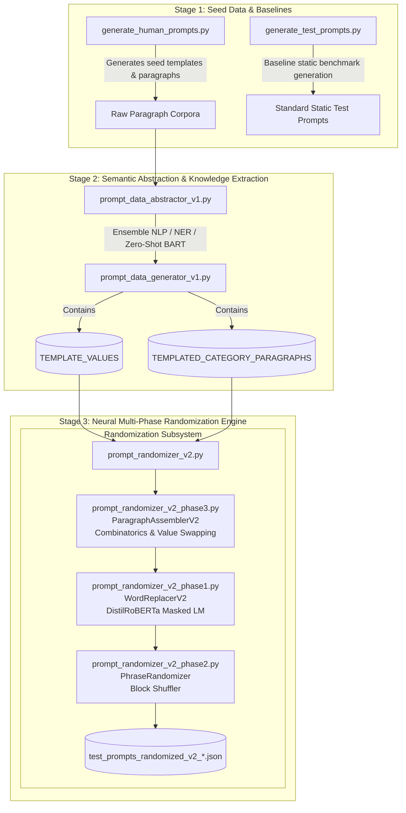
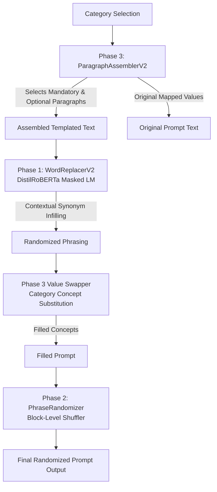

# Benchmark Data Generation & Randomization Architecture

This document provides a comprehensive technical overview of the synthetic dataset generation, semantic abstraction, and multi-phase neural randomization pipeline used in the **Bookito Feature Design Benchmark**.

---

## 1. High-Level Pipeline Overview

The benchmark dataset pipeline is designed to create large-scale, diverse, and technically rigorous engineering prompts across 50 technical categories. The generation flow spans three core stages: **Raw Prompt Formulation & Seeding**, **Semantic Abstraction & Concept Extraction**, and **Neural Multi-Phase Randomization**.



---

## 2. Pipeline Stages & Script Responsibilities

| Step | Script | Primary Responsibility | Input Artifacts | Output Artifacts |
| :--- | :--- | :--- | :--- | :--- |
| **1a** | [generate_human_prompts.py](file:///e:/Development/GitHub/MachineLarning/Bookito/data/generate_human_prompts.py) | Generates initial human-like prompt scenarios across 50 categories using rich context patterns. | `categories.json` | Baseline human prompts (`test_prompts_*.json`) |
| **1b** | [generate_test_prompts.py](file:///e:/Development/GitHub/MachineLarning/Bookito/data/generate_test_prompts.py) | Generates standardized, programmatic benchmark files across 100,000 prompt slots. | `categories.json` | Static benchmark files (`test_prompts_0001-1000.json`, etc.) |
| **2** | [prompt_data_abstractor_v1.py](file:///e:/Development/GitHub/MachineLarning/Bookito/data/prompt_data_abstractor_v1.py) | Multi-model NLP extraction pipeline: extracts concepts, classifies them with zero-shot BART, and templates paragraphs. | Category Paragraph Corpora | [prompt_data_generator_v1.py](file:///e:/Development/GitHub/MachineLarning/Bookito/data/prompt_data_generator_v1.py) |
| **3** | [prompt_data_generator_v1.py](file:///e:/Development/GitHub/MachineLarning/Bookito/data/prompt_data_generator_v1.py) | Source-of-truth data repository housing categorized template values and templated paragraph matrices. | Produced by abstractor | Imported by Randomizer |
| **4** | [prompt_randomizer_v2.py](file:///e:/Development/GitHub/MachineLarning/Bookito/data/prompt_randomizer_v2.py) | High-fidelity neural randomization orchestrator combining combinatorics, DistilRoBERTa MLM word replacement, and block shuffling. | `prompt_data_generator_v1.py` | `test_prompts_randomized_v2_xxxx-yyyy.json` |
| **5** | [prompt_randomizer_v3.py](file:///e:/Development/GitHub/MachineLarning/Bookito/data/prompt_randomizer_v3.py) | LLM-driven prompt rewriting engine interfacing with Chatsito API to transform prompts while preserving domain semantics. | `test_prompts_*.json` | `test_prompts_randomized_v3_xxxx-yyyy.json` |

---

## 3. Detailed Script Breakdown

### 3.1 `generate_human_prompts.py`

#### Objective
Produces diverse, realistic software architecture prompt seeds mimicking real-world staff engineer requests across 50 engineering domains.

#### Libraries and Technologies Used
* **Python Standard Library (`json`, `random`, `os`, `sys`)**:
  The standard Python library provides deterministic random number generation, file system path resolution, and high-performance JSON serialization without introducing third-party runtime dependencies. The `random` module drives parameterized selection across combinatorial prompt templates, while `json` formats and writes prompt datasets into standardized schema structures. Operating system abstraction ensures seamless path resolution and execution across diverse runtime environments.

#### Detailed Logic
1. Combines 10 natural openers (`OPENER_PATTERNS`) with domain-specific architecture challenges across 50 categories (`SPECIFIC_SCENARIOS_BY_CATEGORY`).
2. Embeds quantitative operational metrics (e.g., latency SLAs, request volumes, RAM limits, cluster node sizes) into realistic engineering background statements (`BACKGROUND_CONTEXTS`).
3. Appends structured constraints (`CONSTRAINTS_BY_CATEGORY`) and deliverable expectations (`EXPECTATION_PATTERNS`).
4. Bundles generated items into standardized JSON test suite payloads partitioned into 1,000-prompt chunks.

---

### 3.2 `generate_test_prompts.py`

#### Objective
Creates programmatic baseline prompt datasets mapped across 50 categories and 3 difficulty tiers (`Easy`, `Medium`, `Hard`) for standard evaluation benchmarks.

#### Libraries and Technologies Used
* **Python Standard Library (`hashlib`, `json`, `os`, `sys`)**:
  This script relies on Python's built-in hashing and serialization primitives to enforce deterministic generation across 100,000 prompt records. The `hashlib` and built-in hash functions guarantee stable, repeatable assignment of constraints and expectations to each prompt ID without relying on external state. Standard file I/O streams and JSON formatters chunk the output into 99 batch files with zero external overhead.

#### Detailed Logic
1. Iterates deterministically across 50 categories, selecting specific technical topics from `DOMAINS_BY_CATEGORY`.
2. Applies category-invariant constraints (`CONSTRAINTS_LIST`) and deliverables (`EXPECTATIONS_LIST`).
3. Assigns prompt identifiers (`FEATURE-0001` through `FEATURE-100000`) and distributes 20 prompts per category across 1,000-prompt files (`test_prompts_1001-2000.json` to `test_prompts_99001-100000.json`).

---

### 3.3 `prompt_data_abstractor_v1.py`

#### Objective
An automated Information Extraction (IE) and Semantic Templating pipeline that converts raw text into parameterized templates and classified concept dictionaries using an ensemble of neural models.

#### Libraries and Technologies Used
* **spaCy (`en_core_web_sm`)**:
  spaCy is an industrial-strength Natural Language Processing framework optimized for high-throughput syntactic analysis. The `en_core_web_sm` pipeline performs accurate tokenization, part-of-speech (POS) tagging, and dependency parse tree analysis. In this script, spaCy extracts grammatical noun phrases (`doc.noun_chunks`), identifies proper nouns (`PROPN`), and strips trailing clausal modifiers (`relcl`) and leading stopwords to isolate clean candidate concepts.

* **GLiNER (`urchade/gliner_medium-v2.1`)**:
  GLiNER (Generalist and Lightweight Named Entity Recognition) is a bidirectional transformer model capable of zero-shot and open-vocabulary entity extraction. Unlike traditional NER systems restricted to fixed entity types (such as Person or Location), GLiNER accepts custom entity labels at inference time. In this pipeline, it dynamically identifies technical concepts such as software products, algorithms, hardware modules, and cloud infrastructure components within natural prose.

* **Hugging Face Transformers (`CodeBERT-StackOverflow-NER` & `ITSkillNER`)**:
  The Hugging Face Transformers library provides standardized interfaces for hosting and executing state-of-the-art pretrained neural networks. This script employs two specialized domain models: `CodeBERT` fine-tuned on StackOverflow technical discussions to recognize programming languages, libraries, and protocols, and `ITSkillNER_BERT` fine-tuned on technical resumes to identify professional IT competencies. Combining these models creates an entity extraction ensemble tailored for engineering corpora.

* **Sentence-Transformers & KeyBERT (`all-MiniLM-L6-v2`)**:
  Sentence-Transformers is a dense vector embedding framework that maps full sentences and short phrases into a shared continuous vector space where semantic similarity corresponds to cosine proximity. KeyBERT uses these dense representations to compute the cosine similarity between candidate entity spans and their surrounding sentence context. In this script, it acts as a semantic gatekeeper, scoring whether a candidate phrase is integral to the sentence's meaning or merely generic filler.

* **Facebook BART Zero-Shot Classifier (`facebook/bart-large-mnli`)**:
  BART (Bidirectional and Auto-Regressive Transformers) fine-tuned on Multi-Genre Natural Language Inference (MNLI) is a sequence-to-sequence model capable of zero-shot text classification. By framing candidate concepts as premises and candidate categories as hypotheses, the model predicts the likelihood of each category without requiring domain-specific training data. In this pipeline, it processes concepts on the GPU in mini-batches to classify each term into one of 12 target taxonomy categories.

* **PyTorch (`torch`)**:
  PyTorch is the underlying deep learning framework executing all transformer models within the extraction ensemble. It handles tensor mathematics, memory allocation, and CUDA hardware acceleration. The script leverages PyTorch to automatically detect available GPUs (`cuda:0`) and execute batched neural inferences for maximum throughput.

#### Detailed Logic
1. **Candidate Extraction**: Extracts candidate terms from 650+ paragraphs using SpaCy base noun chunks, standalone `PROPN` tokens, and multi-model entity spans.
2. **Candidate Filtering & Stopword Stripping**: Removes punctuation, clausal modifiers (`relcl`), leading determiners/prepositions, and conjunctions while preserving single-word technologies (`Go`, `Rust`, `Java`).
3. **3-Model Consensus Gate**: Single-word proper nouns and domain entities must pass a multi-model voting gate (`GLiNER` + `StackOverflowNER` + `ITSkillNER`) or achieve a KeyBERT sentence cosine score $\ge 0.30$.
4. **Contextual Zero-Shot Classification**: Groups verified concepts into 12 semantic taxonomy categories:
   * `system_or_project`, `problem_or_issue`, `the_ask`, `the_action`, `technology_or_tool`, `requirement_or_constraint`, `metric_or_scale`, `actor_or_role`, `environment_or_context`, `outcome_or_result`, `action_verb`, `miscellaneous`.
5. **Placeholder Substitution & Emission**: Sorts entity spans by character position in reverse order, substitutes `{category_name_id}` placeholders, and writes `TEMPLATE_VALUES` and `TEMPLATED_CATEGORY_PARAGRAPHS` into [prompt_data_generator_v1.py](file:///e:/Development/GitHub/MachineLarning/Bookito/data/prompt_data_generator_v1.py).

---

### 3.4 `prompt_data_generator_v1.py`

#### Objective
The declarative, static repository of extracted benchmark knowledge serving as the primary source of truth for all downstream randomizers.

#### Libraries and Technologies Used
* **Python Native Data Structures (`dict`, `list`)**:
  This file relies exclusively on native Python data structures to deliver instant, zero-latency in-memory data access. Dictionary hash tables provide $O(1)$ lookups for template placeholder substitutions, while nested category lists organize paragraph templates. By avoiding external database or runtime dependencies, the repository remains completely self-contained and reproducible.

#### Data Structures
* `TEMPLATE_VALUES`: Dictionary mapping 230+ specific concept IDs (e.g. `"technology_or_tool_14": "FastAPI"`) to their clean concept strings.
* `TEMPLATED_CATEGORY_PARAGRAPHS`: Hierarchical mapping of 50 technical categories across 13 standardized paragraph types:
  * `background_project_info`, `specific_project_details`, `problem_overview`, `caveats_and_considerations`, `the_request`, `constraints_and_limitations`, `current_architecture`, `target_audience`, `success_criteria`, `tech_stack`, `expected_output_format`, `assumptions`, `alternative_approaches_rejected`.

---

### 3.5 `prompt_randomizer_v2.py` (and Supporting Phase Modules)

#### Objective
A high-fidelity neural randomization engine that synthesizes grammatically sound, diverse prompt variations using contextual Masked Language Modeling (MLM), combinatorial paragraph assembly, and block shuffling.



#### Libraries and Technologies Used
* **Hugging Face Transformers (`distilroberta-base` Masked LM)**:
  DistilRoBERTa is a compact, distilled variant of the RoBERTa bidirectional transformer trained on Masked Language Modeling (MLM). Because it processes the entire sentence bidirectionally, it evaluates words in their full contextual environment rather than relying on isolated dictionary lookups. In Phase 1, it predicts natural, grammatically correct synonyms for masked tokens while ensuring the resulting sentence reads fluently.

* **spaCy (`en_core_web_sm`)**:
  spaCy provides the morphological and syntactic parsing necessary to guide neural word replacement. It identifies word part-of-speech tags (limiting replacements to nouns, verbs, adjectives, and adverbs) and extracts multi-word collocations. Furthermore, it ensures that predicted synonyms maintain the exact part of speech and grammatical role of the original word.

* **NLTK (`SnowballStemmer`)**:
  The Natural Language Toolkit (NLTK) Snowball stemmer is an algorithmic rule-based stemmer that reduces words to their root linguistic stems. In Phase 1, it compares the stem of candidate replacement words with the stem of original words, preventing the neural model from selecting trivial morphological variations of the same root term.

* **Sentence Transformers (`all-MiniLM-L6-v2`)**:
  Used in Phase 3 concept swapping ([prompt_randomizer_v2_phase3_ckNN.py](file:///e:/Development/GitHub/MachineLarning/Bookito/data/prompt_randomizer_v2_phase3_ckNN.py)) to compute dense 384-dimensional semantic embeddings for all domain concepts and typed slots. At startup, it builds a static nearest-neighbor cosine similarity graph ($O(1)$ lookup at runtime) ensuring placeholders are swapped with semantically aligned peer technologies.

* **PyTorch (`torch`)**:
  PyTorch powers GPU tensor computations for the DistilRoBERTa pipeline. It manages CUDA device mapping, batch tensor execution, and memory transfers to deliver sub-second generation speeds during large-scale prompt synthesis.

#### Component Breakdown & Detailed Logic

* **Phase 3: Combinatorics & Template Swapping ([prompt_randomizer_v2_phase3.py](file:///e:/Development/GitHub/MachineLarning/Bookito/data/prompt_randomizer_v2_phase3.py))**:
  * **Mandatory Section Guarantees**:
    * **Context (1 required)**: Selected from `["background_project_info", "specific_project_details", "current_architecture"]`.
    * **Request (1 required)**: `the_request`.
    * **Requirements / Constraints (1 required)**: Selected from `["problem_overview", "constraints_and_limitations", "success_criteria"]`.
  * **Dynamic Optional Sections (0 to 5 sampled)**: `tech_stack`, `target_audience`, `caveats_and_considerations`, `expected_output_format`, `assumptions`, `alternative_approaches_rejected`.
  * **Logical Ordering**: Arranges paragraphs into natural RFC sections (`Context -> Details/Constraints -> Request/Output`), with a configurable probability of an "Executive Lead" structure (leading with the request).
  * **Cosine k-NN Embedding Concept Swapping ([prompt_randomizer_v2_phase3_ckNN.py](file:///e:/Development/GitHub/MachineLarning/Bookito/data/prompt_randomizer_v2_phase3_ckNN.py))**:
    Replaces `{placeholder}` tokens with semantically closest concept peers using precomputed `all-MiniLM-L6-v2` dense embedding cosine similarity neighbors ($\ge 0.35$, Top-8) within strict slot and category boundaries.
  * **Original Text Rendering (`render_original_prompt`)**: Replaces placeholders with their exact original ground-truth values to enable side-by-side comparison in verbose mode.

* **Phase 1: Neural Lexical Randomization ([prompt_randomizer_v2_phase1.py](file:///e:/Development/GitHub/MachineLarning/Bookito/data/prompt_randomizer_v2_phase1.py))**:
  * Scans eligible tokens (`NOUN`, `VERB`, `ADJ`, `ADV`) with balanced protection for technical acronyms/protocols (`SOC2`, `GDPR`, `OAuth2`, `gRPC`, `GraphQL`, `p99`, `API`), proper nouns (`PROPN`), numeric units (`10ms`, `256MB`), and `{placeholder}` tokens.
  * Replaces eligible content words with high-confidence contextual synonyms predicted by `distilroberta-base`.
  * **Parallel Batched GPU Tensor Inference (`process_prompts_batch`)**: Aggregates all masked candidate sentences across micro-batches of prompts into a single parallel tensor pass on CUDA, maximizing GPU throughput and eliminating sequential pipeline overhead.

* **Phase 2: Structural Phrase Shuffling ([prompt_randomizer_v2_phase2.py](file:///e:/Development/GitHub/MachineLarning/Bookito/data/prompt_randomizer_v2_phase2.py))**:
  * Splits multi-paragraph prompts on double newlines (`\n\n`) and permutes paragraph blocks based on `shuffle_prob` to eliminate structural positioning bias.

* **Main Driver ([prompt_randomizer_v2.py](file:///e:/Development/GitHub/MachineLarning/Bookito/data/prompt_randomizer_v2.py))**:
  * Orchestrates the complete generation workflow, chunking prompt synthesis into GPU micro-batches and writing 1,000-prompt batch files to `test_prompts_randomized_v2_xxxx-yyyy.json`.
  * **Complete Suite of Configurable Randomization Knobs**:
    * **1. Non-Templated Word Randomization**:
      * `--word-prob`: Probability (0.0 to 1.0) of replacing an eligible non-templated word in the paragraph with a DistilRoBERTa synonym (default: `1.0`).
      * `--word-threshold`: Minimum confidence score threshold (0.0 to 1.0) required for a DistilRoBERTa fill-mask predicted word (default: `0.05`).
    * **2. Template Value Randomization**:
      * `--template-value-prob`: Probability (0.0 to 1.0) of swapping a `{category_id}` placeholder with a random concept from that category; values $< 1.0$ retain original ground-truth terms (default: `1.0`).
    * **3. Paragraph Quantity Randomization**:
      * `--min-optional-paragraphs`: Minimum number of optional paragraphs to include beyond the 3 mandatory paragraphs (default: `0`, min total = `3`).
      * `--max-optional-paragraphs`: Maximum number of optional paragraphs to include beyond the 3 mandatory paragraphs (default: `5`, max total = `8`).
    * **4. Paragraph Combination Randomization**:
      * `--optional-paragraph-prob`: Probability (0.0 to 1.0) of each optional paragraph type being eligible for candidate sampling (default: `1.0`).
    * **5. Paragraph Order Randomization**:
      * `--section-shuffle-prob`: Probability (0.0 to 1.0) of shuffling the internal order of paragraphs within each logical section (default: `1.0`).
      * `--executive-lead-prob`: Probability (0.0 to 1.0) of inverting prompt structure to place the Request section at the very top ('Executive Lead' style) (default: `0.20`).
      * `--shuffle-prob`: Probability (0.0 to 1.0) of performing global block-level paragraph shuffling across the entire prompt in Phase 2 (default: `0.50`).
    * **Performance & Execution Controls**:
      * `--batch-size`: Number of prompts to process simultaneously on GPU in a single tensor batch (default: `50`).
      * `--quantity`: Total number of synthetic prompts to generate across all categories (default: `1000`).
      * `--verbose`: Displays side-by-side comparisons of the `ORIGINAL` (ground truth values and sequence) against the `RANDOMIZED` output for every item.

---

### 3.6 `prompt_randomizer_v3.py`

#### Objective
An LLM-driven semantic prompt rewriting orchestrator of last resort that leverages local models served via Chatsito's API to rewrite whole engineering prompts with major syntactic variation and category-preserving concept substitutions.

#### Libraries and Technologies Used
* **Python Standard Library (`json`, `glob`, `os`, `sys`, `time`, `argparse`)**:
  Manages CLI argument validation, source dataset discovery, and standardized JSON output serialization.

* **HTTP Streaming Client (`requests`)**:
  Maintains persistent HTTP streaming connections to Chatsito's local API (`http://localhost:5257/api/chat/stream`), parsing server-sent event (SSE) data chunks in real time.

* **Chatsito Local LLM Server**:
  A local inference server hosting verified open-weight models (`qwen3.5:9b`, `gemma4:e2b`, `granite4.1:8b`, `phi4-mini:3.8b`, `qwen3.5:4b`, `qwen3.8:latest`) to perform zero-shot prompt restructuring.

#### Detailed Logic
1. Scans `data/` for original benchmark files (`test_prompts_*.json`), ignoring any existing randomized sets.
2. Filters prompts by 1-based index range specified via `--index_start` and `--index_end`.
3. Formats a structured user message combining the prompt's `primaryCategory` and source text.
4. Transmits the payload along with a comprehensive few-shot system prompt guiding the LLM to identify main concepts, replace them with domain-appropriate alternatives, and permute sentence structure.
5. Collects and parses the streamed completion, saving output batches of 1,000 prompts into `test_prompts_randomized_v3_xxxx-yyyy.json`.

---

## 4. Output JSON Schema Specification

All generated batch files adhere to the standard benchmark dataset schema:

```json
{
  "testSuite": "Bookito Feature Design Benchmark Randomized v2",
  "version": "2.0",
  "promptCount": 1000,
  "prompts": [
    {
      "id": "FEATURE-0001",
      "primaryCategory": "Software Feature",
      "difficulty": "Easy",
      "prompt": "We are building an event-driven notification dispatch engine...\n\nPlease provide a comprehensive technical specification..."
    }
  ]
}
```
